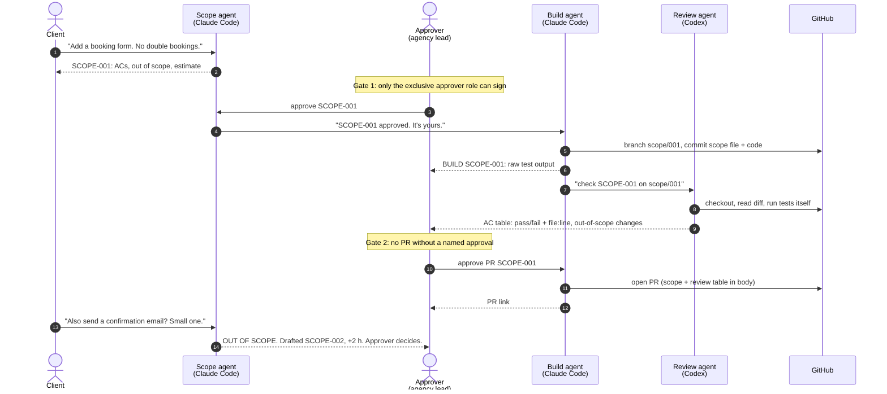
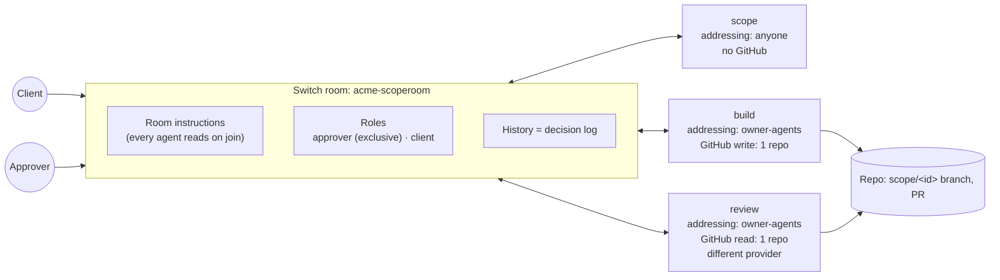

<div align="center">

# ScopeRoom

### Turn a vague client message into a signed scope, an independently reviewed PR, and a scope-creep guard. All in one team chat room.

**Three AI agents. Two human sign-offs. Zero copy-paste.**

[](https://www.wemakedevs.org/hackathons/switch)
[](https://github.com/sandbox-quantum/switch)
[](#the-agents)
[](LICENSE)

[**Demo video**](#demo-video) · [**Run it in 10 minutes**](#run-it-in-10-minutes) · [**How it works**](#how-it-works) · [**Why Switch is load-bearing**](#why-switch-is-load-bearing)

</div>

---

## The problem every agency knows

A client drops a message in chat: *"Can we add a booking form? Should be quick."*

What happens next is how small agencies lose money:

- **Nobody writes it down.** Three weeks later, nobody can say what was agreed.
- **"One small change" piles up.** Each extra ask is never priced, because nobody checks it against what was signed.
- **The AI does the work where only one dev can see it.** The reasoning, the test output and the trade-offs die in a terminal.
- **The agent that wrote the code also "reviews" it.** That's not a review.

## What ScopeRoom does

ScopeRoom puts the client, the agency lead and three AI agents in **one Switch room** in Mattermost, Slack, Discord or Teams. Every request ends in a real artifact: a **signed scope file** and a **pull request** that an **independent agent** has checked against every acceptance criterion.

| | Without ScopeRoom | With ScopeRoom |
|---|---|---|
| Request | A chat message | `SCOPE-001` with testable ACs, out-of-scope list, estimate |
| Agreement | "I think we said..." | `approve SCOPE-001` by the one approver, logged in the room |
| Build | One dev's terminal | Branch `scope/001`, raw test output in the thread |
| Review | Same agent grades itself | A **different provider** checks each AC with file:line evidence |
| Ship | Whoever pushes first | `approve PR SCOPE-001`, then the PR link appears |
| "Quick extra thing" | Silently absorbed | **Flagged out of scope, drafted as SCOPE-002 with a price** |

---

## How it works



### The room is the contract



---

## The agents

| Agent | Provider | Job | Who can talk to it | Access | Can't |
|---|---|---|---|---|---|
| **`scope`** | Claude Code | Writes `SCOPE-<id>` (ACs, out of scope, estimate, risks). Classifies later asks as in or out of scope and prices the delta. | `anyone` (clients need it) | Reads the repo, no GitHub grant | Write code, touch git |
| **`build`** | Claude Code | Branches `scope/<id>`, commits the signed scope, implements only the ACs, runs tests, pastes raw output, opens the PR after Gate 2. | `owner-agents` | GitHub **write**, one repo | Start before Gate 1, open a PR before Gate 2, push to main |
| **`review`** | **Codex** (deliberately different) | Checks out the branch, runs the tests itself, posts a pass/fail table per AC with evidence, flags out-of-scope edits. | `owner-agents` | GitHub **read**, one repo | Change code |

**Safety by design:** `auto_approve: false` on every agent, so risky tool calls still raise a request in the room. GitHub grants are scoped to one repository, not the account. The approver role is `exclusive: true`, so two people can't both believe they hold the pen.

---

## Why Switch is load-bearing

We ran the **remove-Switch test**. Take Switch out and:

1. **Review can't see Build's work.** They're separate sessions on different providers with different directories and different GitHub grants. Switch is what makes them one conversation.
2. **Approvals have nowhere to live.** The exclusive `approver` role, the room instructions that every agent reads on joining, and the room history that records who signed what are all Switch features.
3. **The client sees nothing.** Without the bridge, the work happens in a terminal again.
4. **Permissions collapse.** `addressing: owner-agents` is why a client typing `@build just start` gets refused. A webhook bot can't tell those people apart.

| Switch feature | How ScopeRoom uses it |
|---|---|
| Multi-agent rooms | 3 agents, 2 providers, 1 room |
| Room instructions | The six rules every agent obeys (see [ROOM-RULES.md](ROOM-RULES.md)) |
| Roles (`exclusive`) | `approver` gate, `client` role |
| Addressing | `anyone` for Scope, `owner-agents` for Build and Review |
| Connections | GitHub write for Build, read for Review, one repo each |
| `auto_mode` / `auto_approve` | Auto mode on, bypass off everywhere |
| Aliases | `@scope`, `@build`, `@review` |
| Room docs | `ROOM-RULES` attached for humans joining later |
| Kickoff | Each agent states what it will and won't do |
| Templates | The whole setup is one file: [`scoperoom.template.yaml`](scoperoom.template.yaml) |

---

## Demo video

> **[Watch the 3-minute demo](#)** <!-- TODO: paste YouTube/Loom link before submitting -->

What you'll see: a client request becomes SCOPE-001 → the client tries to approve and gets refused → the approver signs → Build ships a branch with real test output → Codex reviews every AC → PR opens → the client asks for "one small thing" and Scope catches it as SCOPE-002 with a price.

Script: [`demo/script.md`](demo/script.md)

---

## Run it in 10 minutes

### Prerequisites

- [Switch Console](https://docs.switchagents.ai/switch-rooms/getting-started/install-switch-console) and Docker. Mattermost ships with it, so no Slack admin is needed.
- **Claude Code** and **Codex** installed and signed in. Check in Console under *Settings → Agent providers*. One provider works too; see [Fallbacks](#fallbacks).
- GitHub connected in Console under *Settings → Connections*.
- Node 20+ and pnpm, if you want to run the demo app yourself.

### Steps

1. **Fork this repo.** Build will push branches to your fork.
2. **Open Switch Console → Templates → New**, paste [`scoperoom.template.yaml`](scoperoom.template.yaml), and save.
3. **Fill the form:**
   - `team`: any lowercase prefix, e.g. `acme`
   - `repository`: your fork, e.g. `you/scoperoom`
   - Advanced: providers (Claude for scope/build, Codex for review), machine, folders. Defaults are fine.
4. **Create.** Switch checks everything before creating anything. If a provider isn't signed in or GitHub isn't connected, it tells you exactly what (`provider_login_missing`, `connector_not_connected`) and creates nothing.
5. **Open the room** `acme-scoperoom`. Give yourself the `approver` role and a teammate the `client` role. Then verify, sending each as its own message:

| Command | Proves |
|---|---|
| `!list-agents` | All 3 agents are in the room |
| `!agents-status` | All 3 have live sessions |
| `!roles` | `approver` exists and is exclusive |
| `!list-aliases` | `scope`, `build`, `review` resolve |
| `!list-documents` | `ROOM-RULES` is attached |

6. **As the client, post:**
   > @scope Can we add a booking form to the studio page? Name, email and a date, and two people can't book the same day.

Then follow [`demo/script.md`](demo/script.md).

### Run the demo app locally (optional)

```bash
cd demo-app
pnpm install
pnpm test        # 4 baseline tests pass
pnpm dev         # http://localhost:3000
```

The baseline app lists bookings but has **no form and no double-booking check**. That is the work SCOPE-001 asks for, so the agents have a real change to make on camera.

---

## Approval phrases

| Phrase | Who | What happens |
|---|---|---|
| `approve SCOPE-<id>` | approver | Build starts on `scope/<id>` |
| `reject SCOPE-<id>: <reason>` | approver | Scope restates the reason; nothing is built |
| `approve PR SCOPE-<id>` | approver | Build opens the PR and posts the link |

Anyone else saying these gets a polite "only the approver can approve."

---

## Repository layout

```
scoperoom/
├── scoperoom.template.yaml   ← the whole Switch setup: 3 agents, room, roles, rules, kickoff
├── ROOM-RULES.md             ← the conventions every agent reads
├── demo/script.md            ← exact messages for the demo
├── demo-app/                 ← Next.js 15 + TS + Tailwind + Vitest app the agents change
├── scope/                    ← SCOPE-<id>.md files land here, committed by Build
└── PRD.md · Techspec.md · Appflow.md · Schema.md · ImplementationPlan.md
    Tracker.md · Rules.md · Security.md · Structure.md   ← full product and engineering docs
```

---

## Troubleshooting

| Switch says | Fix |
|---|---|
| `Starting a session to handle this` | Normal. Wait a few seconds. |
| `I'm not online in this room` | Switch Console isn't running on the owner's machine. |
| `I don't have a session connected to this room` | Start the agent's session. `!run-cmd` prints the command. |
| `You're not permitted to direct messages to me in this room` | **Working as designed.** Build and Review are `owner-agents`. |
| `I only take instructions from my owner` | Link your chat account to Switch. |
| Agent looks silent | Check the **thread** under your message. Switch replies in threads. |

> ⚠️ A message that **starts** with `!` runs as a command, even inside backticks. Never paste `!reset` to show someone the syntax.

### Fallbacks

- **Only one provider installed?** Set both provider params to it. Review still runs as a separate agent with its own directory and read-only grant, but you lose the second model's opinion.
- **No GitHub connection?** Build can push with the machine's git credentials. Leave the `connections` block out, and the agent posts a compare link.

---

## Security model

- Client input is untrusted: clients can't approve and can't address Build or Review.
- Repo text is data: Review flags code comments that try to instruct it.
- Least privilege: write on one repo for one agent only.
- No bypass: `auto_approve: false` everywhere.
- No secrets in the repo, and the demo data is synthetic.

Full threat model: [Security.md](Security.md).

---

## Built with

[Switch](https://github.com/sandbox-quantum/switch) · Claude Code · Codex · Mattermost · Next.js 15 · React 19 · TypeScript · Tailwind CSS 4 · Vitest · zod

## Author

**Muhammad Faizan**, full-stack and agentic-AI engineer from Lahore.
[Portfolio](https://faizi-dev.vercel.app/) · [GitHub](https://github.com/MuhammadFaizan-prog) · [LinkedIn](https://linkedin.com/in/muhammad-faizan-60518a290)

Built for the **Flip the Switch Hackathon** (WeMakeDevs × DevTools Academy × Switch), Nov 4–7, 2026. #HowISwitch

<div align="center"><sub>MIT licensed. The room is the contract.</sub></div>
